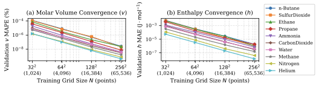
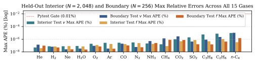

# `realgas-ml` (v0.3.0) — Dense-Data Local Quintic RBF Surrogates for Peng–Robinson Real-Gas Thermodynamics

**Authors:** Satwik Gupta (`2025CH11012`) & Udhav Jaipuria (`2025CH11729`)  
**Course Project:** Chemical Engineering Thermodynamics · Department of Chemical Engineering  
**Technical Report:** [**`report/realgas_ml_report.pdf`**](report/realgas_ml_report.pdf) ([LaTeX Source](report/realgas_ml_report.tex))

`realgas-ml` is a self-contained thermodynamic calculation engine and local kernel regression package that predicts the pressure–volume–temperature ($PVT$), caloric ($h, s$), and phase-equilibrium departure ($\phi, f$) properties of **15 pure supercritical fluids**. Each fluid is trained on **$65{,}536$ analytical states** ($983{,}040$ states in total) synthesized directly from the classical [Peng–Robinson (1976) cubic equation of state](https://doi.org/10.1021/i160057a011) coupled with continuous [NASA 7-coefficient ideal-gas heat-capacity polynomials](https://ntrs.nasa.gov/citations/19940013151). No external runtime property library (such as CoolProp or Cantera) is called during training or inference.

## Repository Structure

```text
realgas_ml/
├── realgas_ml/                      # Core Python package
│   ├── __init__.py                  # Public package exports (GasModel, gases)
│   ├── peng_robinson.py             # Analytical PR76 EOS, NASA7 integrals & departures
│   ├── regressor.py                 # Local quintic RBF interpolator (k=48, degree=2)
│   ├── model.py                     # Forward (T,P) prediction & Brentq inverse P(T,v) solver
│   ├── cli.py                       # Command-line entry point (realgas-ml)
│   └── data/                        # Fluid constants, trained models, datasets & metrics
│       ├── fluid_parameters.json    # Critical constants, NASA7 polynomials & provenance
│       ├── metadata.json            # Package metadata & training configuration
│       ├── <Fluid>.joblib           # Serialized LocalRBFRegressor models (15 fluids)
│       ├── <Fluid>_dataset.npz      # Compressed train/val/test/boundary splits (15 fluids)
│       └── <Fluid>_metrics.json     # Validation learning curves & held-out errors (15 fluids)
├── report/                          # Project report & convergence figures
│   ├── realgas_ml_report.pdf        # Compiled 4-page technical report
│   ├── realgas_ml_report.tex        # LaTeX manuscript source
│   ├── fig_learning_curves.pdf      # Multi-grid validation convergence figure (PDF)
│   ├── fig_learning_curves.png      # Multi-grid validation convergence figure (PNG)
│   ├── fig_test_boundary_errors.pdf # Interior vs. boundary error benchmark figure (PDF)
│   └── fig_test_boundary_errors.png # Interior vs. boundary error benchmark figure (PNG)
├── tests/                           # Automated pytest suite (47 tests)
│   ├── test_properties.py           # Maxwell relations, Gibbs-Helmholtz & surrogate gates
│   └── test_app.py                  # Streamlit UI, unit conversion & molar scaling tests
├── .streamlit/config.toml           # Streamlit laboratory theme configuration
├── .gitignore                       # Standard Python, pytest & LaTeX ignore rules
├── app.py                           # Interactive Streamlit web laboratory
├── train.py                         # End-to-end PR76 dataset generation & RBF training loop
├── export_data.py                   # Bulk NPZ-to-CSV dataset exporter
├── example.py                       # Minimal Python API usage script
├── run_app.bat                      # Windows launcher for the Streamlit UI
├── pyproject.toml                   # Build specification & dependencies
└── THIRD_PARTY_NOTICES.txt          # BSD 3-Clause license notice for static NASA7 tables
```

## Quickstart

### 1. Browser Interface (Recommended)

Clone the repository and install the package with optional Streamlit UI dependencies:

```bash
git clone https://github.com/satwikgupta122/realgas_ml.git
cd realgas_ml
python -m pip install ".[ui]"
python -m streamlit run app.py
```

Open `http://localhost:8501` if the browser does not open automatically (Windows users can double-click `run_app.bat` after installation). Choose a gas and specify temperature (`K` or `°C`), pressure (`bar`, `kPa`, `MPa`, or `Pa`), and molar amount (`mol`), or switch to **Temperature + molar volume** mode for inverse $P(T,v)$ lookups. You can compare surrogate predictions side-by-side against direct Peng–Robinson calculations, plot 80-point geometric-pressure curves, and export results to CSV.

### 2. Python API & Command-Line Interface

Use Python 3.11 or newer:

```bash
python -m pip install .
python example.py
realgas-ml --gas CarbonDioxide --T 400 --P 2000000 --n 2
```

In Python:

```python
from realgas_ml import GasModel
from realgas_ml.peng_robinson import properties

# Surrogate ML prediction + inverse P(T,v) solver
model = GasModel("CarbonDioxide")
result = model.predict(T=400, P=2000000, n=2)
print(result["fugacity_Pa"], result["phi"], result["H_J"], result["S_J_K"])
print("Recovered P [Pa]:", model.pressure(T=400, v=result["v_m3_mol"]))

# Direct analytical Peng-Robinson calculation (without loading ML model)
print(properties(400, 2000000, "CarbonDioxide"))
```

Inputs use SI units: temperature in kelvin (`K`), pressure in pascals (`Pa`), and amount in moles (`mol`). Outputs include `Z`, `v_m3_mol`, `V_m3`, `rho_kg_m3`, `h_J_mol`, `s_J_mol_K`, `H_J`, `S_J_K`, `phi`, and `fugacity_Pa` (fugacity is an intensive state variable and does not scale with `n`).

### 3. Training, Data Export & Testing

```bash
python train.py                                      # Regenerate all 15 datasets & models
python train.py --gas CarbonDioxide                  # Train a single fluid
python export_data.py --gas CarbonDioxide --output co2.csv
python -m pip install ".[test]"
python -m pytest -q                                  # Run all 47 automated tests
```

## Supported Fluids & Operating Domains

All 15 pure fluids operate over $P \in [1.0, 50.0]\;\text{bar}$ ($[10^5, 5\times 10^6]\;\text{Pa}$) and strictly supercritical temperatures $T \ge \max(300.0\;\text{K}, 1.10\,T_c)$ as specified in [`realgas_ml/data/fluid_parameters.json`](realgas_ml/data/fluid_parameters.json):

| Fluid | Species | $M$ ($\text{g/mol}$) | $T_c$ ($\text{K}$) | $P_c$ ($\text{bar}$) | $\omega$ | $T_{\min}$–$T_{\max}$ ($\text{K}$) | $T_r = T/T_c$ Range |
| :--- | :--- | ---: | ---: | ---: | ---: | ---: | ---: |
| **Helium** | $\text{He}$ | 4.0026 | 5.1953 | 2.2832 | $-0.38354$ | 300.00–600.00 | 57.74–115.49 |
| **Hydrogen** | $\text{H}_2$ | 2.0159 | 32.9800 | 12.9300 | $-0.21700$ | 300.00–600.00 | 9.10–18.19 |
| **Neon** | $\text{Ne}$ | 20.1790 | 44.4000 | 26.6163 | $-0.03549$ | 300.00–600.00 | 6.76–13.51 |
| **Nitrogen** | $\text{N}_2$ | 28.0135 | 126.2000 | 33.9000 | $0.03800$ | 300.00–600.00 | 2.38–4.75 |
| **CarbonMonoxide** | $\text{CO}$ | 28.0101 | 133.4000 | 35.0000 | $0.06600$ | 300.00–499.00 | 2.25–3.74 |
| **Argon** | $\text{Ar}$ | 39.9480 | 150.6870 | 48.6300 | $-0.00219$ | 300.00–600.00 | 1.99–3.98 |
| **Oxygen** | $\text{O}_2$ | 31.9988 | 154.5800 | 50.4300 | $0.02200$ | 300.00–600.00 | 1.94–3.88 |
| **Methane** | $\text{CH}_4$ | 16.0428 | 190.7000 | 46.3000 | $0.01100$ | 300.00–600.00 | 1.57–3.15 |
| **CarbonDioxide** | $\text{CO}_2$ | 44.0098 | 304.2000 | 73.9000 | $0.22800$ | 334.62–600.00 | 1.10–1.97 |
| **Ethane** | $\text{C}_2\text{H}_6$ | 30.0690 | 305.4000 | 48.8000 | $0.09900$ | 335.94–600.00 | 1.10–1.96 |
| **Propane** | $\text{C}_3\text{H}_8$ | 44.0956 | 369.7000 | 42.5000 | $0.15300$ | 406.88–628.81 | 1.10–1.70 |
| **Ammonia** | $\text{NH}_3$ | 17.0305 | 405.5600 | 113.6339 | $0.25569$ | 446.12–689.45 | 1.10–1.70 |
| **n-Butane** | $n\text{-C}_4\text{H}_{10}$ | 58.1222 | 425.6000 | 37.6000 | $0.19900$ | 468.16–574.00 | 1.10–1.35 |
| **SulfurDioxide** | $\text{SO}_2$ | 64.0638 | 430.6400 | 78.8658 | $0.25613$ | 473.70–524.00 | 1.10–1.22 |
| **Water** | $\text{H}_2\text{O}$ | 18.0153 | 647.0960 | 220.6400 | $0.34429$ | 711.81–1100.06 | 1.10–1.70 |

## Thermodynamic Formulation & Surrogate Architecture

For molar volume $v$, the PR76 equation of state implemented in [`realgas_ml/peng_robinson.py`](realgas_ml/peng_robinson.py) is:

$$P(T,v) = \frac{RT}{v - b} - \frac{a(T)}{v^2 + 2bv - b^2}, \qquad a(T) = 0.45724\,\frac{R^2T_c^2}{P_c}\left[1 + \kappa\left(1 - \sqrt{\frac{T}{T_c}}\right)\right]^2, \qquad b = 0.07780\,\frac{RT_c}{P_c}$$

where $\kappa = 0.37464 + 1.54226\,\omega - 0.26992\,\omega^2$. Defining $A = aP/(RT)^2$, $B = bP/(RT)$, and $L = \ln[(Z + (1 + \sqrt{2})B)/(Z + (1 - \sqrt{2})B)]$:

- $\ln\phi = Z - 1 - \ln(Z - B) - \frac{A}{2\sqrt{2}B}L$ and fugacity $f = \phi P$
- $h_{\text{dep}} = RT(Z - 1) + \frac{T(da/dT) - a}{2\sqrt{2}b}L$
- $s_{\text{dep}} = R\ln(Z - B) + \frac{da/dT}{2\sqrt{2}b}L$

Ideal-gas $h_{\text{ig}}(T)$ and $s_{\text{ig}}(T)$ are integrated analytically from NASA7 polynomials relative to $h_{\text{ig}} = s_{\text{ig}} = 0$ at $300\;\text{K}$ and $1\;\text{bar}$. In [`realgas_ml/regressor.py`](realgas_ml/regressor.py), `LocalRBFRegressor` fits $\mathbf{y} = [\ln Z, h, s, \ln\phi]^\top$ over normalized $(T, \ln P) \in [0, 1]^2$ using a 48-neighbor local quintic radial basis function ($\varphi(r) = -r^5$) augmented by a degree-2 polynomial trend.

## Validation Results

All 47 automated tests pass (`pytest -q`). Across all 15 gases and both held-out interior ($N=2{,}048$) and boundary ($N=256$) test sets, the worst-case interpolation errors against direct PR76 are:

| Quantity | Global Worst-Case Error | Pytest Gate |
| :--- | ---: | ---: |
| `v_max_APE_percent` | `1.0365e-05 %` | `< 0.01 %` |
| `fugacity_max_APE_percent` | `1.49849e-06 %` | `< 0.01 %` |
| `h_J_mol_max_AE` | `0.000409671 J/mol` | `< 0.5 J/mol` |
| `s_J_mol_K_max_AE` | `8.24171e-07 J/(mol·K)` | `< 0.005 J/(mol·K)` |





## Sources & Provenance

- Peng, D.-Y., & Robinson, D. B. (1976), *A New Two-Constant Equation of State*: https://doi.org/10.1021/i160057a011
- McBride, B. J., Gordon, S., & Reno, M. A. (1993), *NASA TM-4513*: https://ntrs.nasa.gov/citations/19940013151
- Cantera 3.2.0 Species Thermodynamic Polynomials (`nasa_gas.yaml` & `critical-properties.yaml`): https://www.cantera.org/stable/reference/thermo/species-thermo.html
- Maginn, E. J., *CBE 20260 Fugacity from Equations of State*: https://ejmaginn.github.io/CBE20260-notes/class34/fugacity-EOS.html
- License notices for static coefficient tables are preserved in [`THIRD_PARTY_NOTICES.txt`](THIRD_PARTY_NOTICES.txt).
